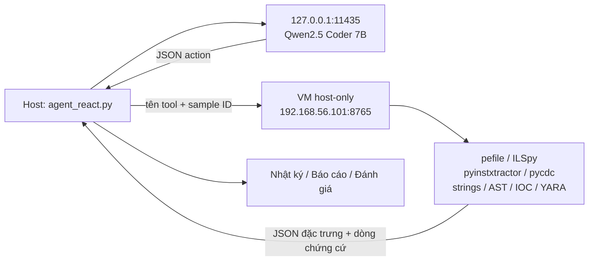

# StealerLab — Đồ án Phân tích mã độc

StealerLab là đồ án phân tích tĩnh stealer .NET/Python bằng agent ReAct. Trên Windows, người dùng mở web cục bộ và Qwen3 8B chọn phép tìm tiếp theo. VM Ubuntu giữ mẫu, chạy các công cụ đọc tĩnh và trả đặc trưng có tọa độ nguồn. Khi thiếu bằng chứng cho một đường nối, bản đồ giữ trạng thái chờ kiểm tra.

## Demo trực tiếp

Để demo .NET, mở **Bản đồ chứng cứ → Đọc kết quả truy vấn**, chọn một dòng dùng chỉ số cột rồi bấm **Tìm lược đồ trong VM → Tra cứu chứng cứ**. Giảng viên có thể xem dấu vết Qwen chọn phép kiểm và mở kết quả công cụ ngay trên máy chạy lab. Tab **Đánh giá → Mercurial → Kiểm tra câu gán tên cho cột số** cho thấy việc kiểm chứng đã thay đổi những câu nào. [Kịch bản và số đo thực tế](docs/KIEM_LUOC_DO.md)

Web dùng Qwen3 8B trên Windows và công cụ phân tích tĩnh trong VM Ubuntu. Nhóm có thể trình bày bằng chứng của từng mắt xích, hỏi tiếp về phần còn thiếu và kiểm vì sao Qwen đưa ra verdict. [Đối chiếu kết luận và nhật ký thật](docs/DOI_CHIEU_KET_LUAN.md)

Trên máy đã dựng lab, mở PowerShell trong thư mục dự án và chạy lệnh dưới đây. Trên máy thành viên mới, hoàn thành bước cài VM, model và bộ công cụ trước. [Hướng dẫn cài đặt](docs/TEAM_SETUP.md)

```powershell
.\scripts\Start-Web.ps1
```

1. Mở `http://127.0.0.1:4180`, kiểm tra trạng thái Ollama và VM, chọn **public_python2024.bin** và bấm **Chạy điều tra**. Tab **Nhật ký** hiển thị công cụ agent đang gọi trong lượt mới.
2. Mở **Bản đồ chứng cứ → Đọc kết quả truy vấn → Xử lý dữ liệu**. Bấm **Xem đoạn mã đã dẫn**, đối chiếu bên gọi và bên nhận. Nút **Mở C… trong báo cáo** đưa tới nhận định của đúng lượt. Một số đường nối khác có thể còn thiếu bằng chứng.
3. Trong **Hỏi đáp**, hỏi “Bản ghi nào được truyền vào hàm xử lý?”. Mở nguồn của câu trả lời. Chuyển sang **YARA** để xem kết quả quét mẫu, hoặc **Gán nhãn** để đối chiếu và đánh dấu một vị trí.
4. Trong **Đánh giá**, mở **Từ trường truy vấn đến hàm xử lý · hai lượt Python** để so với ba lượt trước. Khi hết demo, đợi tác vụ hoàn tất rồi bấm **Tắt lab**. [Chứng cứ và phạm vi kết luận](docs/KIEM_TRA_DOI_SO.md) · [Thao tác trên web](docs/WEB_DIEU_TRA.md)

**Sản phẩm đang phát triển, chưa đạt toàn bộ tiêu chí chất lượng.** Repo chính: [Gera-YCYC/PhanTichMaDoc-Stealer](https://github.com/Gera-YCYC/PhanTichMaDoc-Stealer). Source ở root; model và mẫu public mã hóa ở Release có khóa hash. Tài liệu bàn giao là Markdown kỹ thuật, không cần thông tin sinh viên.

Bản `coverage-8b` chạy Qwen3 8B và kiểm lại từng thao tác tĩnh bằng kết quả công cụ trước khi tổng hợp kết luận. Trên PythonStealer 2024, agent gọi 4 công cụ thật trong VM, xác định kênh SMTP và phủ 22/36 đơn vị tham chiếu. F1 đạt 72,13%, dưới mục tiêu 75% của môn. [Cách chạy, số đo và lỗi còn lại](docs/DEMO_COVERAGE.md).

Web điều tra dùng Qwen3 8B. Luồng dòng lệnh mặc định dùng Qwen2.5 Coder 7B. Thành phần nhóm đã train là bộ xếp hạng kết quả tìm mã. Giảng viên có thể xem hai job Windows và Ubuntu thực hiện 300 bước cập nhật rồi so trọng số, loss và kết quả xếp hạng. Qwen dùng trọng số có sẵn. [Hồ sơ training](training/RANKER_EXPERIMENT.md) · [Hai lần train trong GitHub Actions](https://github.com/Gera-YCYC/PhanTichMaDoc-Stealer/actions/runs/46092717873).

[Luồng YARA thật](docs/YARA_REAL_CORPUS.md) vẫn giữ số đo5/5 mẫu độc development và0/39 file sạch báo nhầm với cả7B/8B, replay độc lập khớp. [Báo cáo v8](docs/OPERATIONS_CONTEXT_V8.md) chưa đạt: Python8/11 câu đủ căn cứ, .NET14/20. Không ghép điểm các phiên bản để nghiệm thu. Xem [trạng thái](docs/STATUS.md), [đối chiếu nhận định](docs/CLAIM_AUDIT.md), [đơn vị tham chiếu](eval/reference_units/README.md).

Bản ban đầu của nhóm được giữ nguyên trong [legacy/initial-version](legacy/initial-version/), kèm hash tại [manifest bảo toàn](docs/legacy-source-manifest.json). Khi chạy bản hiện tại, dùng `agent_react.py` và `scripts/Run-Demo.ps1` ở thư mục gốc; các báo cáo mô phỏng trong legacy chỉ là lịch sử phát triển.

**Demo buổi 6 đã có ba mẫu hoàn tất trên cùng cấu hình Qwen3 8B.** Đợt đo gồm bốn mẫu, trong đó lượt AgentTesla ban đầu kết thúc với báo cáo rỗng. Video 72 giây dựng lại các bước và số đo từ nhật ký thật của cả bốn lượt. [Video](deliverables/Demo_phan_tich_tinh.mp4) · [Bằng chứng cùng cấu hình](deliverables/real-demo-evidence/coverage-v11-batch.json) · [Bảng đối chiếu nhận định của agent](docs/PHIEU_DANH_GIA.md).

## Giảng viên và thành viên nhóm bắt đầu tại đây

Để trình diễn một câu hỏi có thể kiểm ngay trên mã, mở phụ lục Mercurial và để Qwen chọn lời gọi cho VM tìm thân hàm. Bản đồ cho mở lại dòng chứng minh thao tác đọc tệp hoặc thao tác HTTP. Gomorrah có ví dụ agent đã thử ba lần và dừng khi thiếu nguồn. [Kịch bản demo và số liệu đối chứng](docs/DOI_CHIEU_THAN_HAM.md)

Để demo trực tiếp nhánh .NET, dùng profile `techniques-8b` với Mercurial. Lượt v13 tìm được cấu hình webhook ở dòng 37, trích đủ chứng cứ cho T1539 và xác nhận mẫu khớp luật YARA. Khi thầy hỏi về sai số, có thể mở dòng 1928 để giải thích vì sao nhóm loại URL ảnh đại diện khỏi các IOC của kênh gửi. [Lệnh chạy, kết quả và bảng chấm Mercurial](docs/DEMO_COVERAGE.md#demo-mercurial-với-chứng-cứ-ioc-và-attck).

| Cần xem | Tài liệu |
|---|---|
| Mục tiêu, kiến trúc, cách xây dựng, luồng chạy, vì sao chọn model/mẫu | [Thuyết minh chi tiết](docs/THUYET_MINH_DU_AN.md) |
| Thông số I/J, slide, file đề xuất gốc và chỉ tiêu chấm | [Nguồn yêu cầu giảng viên](docs/YEU_CAU_GIANG_VIEN.md) |
| Đã train như thế nào? | [Hồ sơ training](training/README.md): ranker ML đã train thật với loss/checkpoint; SLM chưa fine-tune |
| Những việc chưa xong đến cuối môn | [Backlog có vai trò/điều kiện đóng](docs/CONG_VIEC_CON_LAI.md) |
| Cài và chạy trên máy thành viên | [Hướng dẫn từng bước](docs/TEAM_SETUP.md) |
| Demo, log thực và giới hạn | [Buổi 4](docs/BUOI_4.md), [STATUS](docs/STATUS.md) |

Prompt/schema/guard hoặc tải model không phải huấn luyện trọng số. Yêu cầu train chưa được GV làm rõ là fine-tune SLM hay ML phụ trợ; hồ sơ không có epoch/loss/checkpoint giả.

Dự án trên ổ C. Web điều tra dùng `qwen3:8b`. Cấu hình CLI buổi 4 dùng `qwen2.5-coder:7b` Q4_K_M, 7.615.616.512 tham số, kho model `private/ollama-models` trên C. Model cũ `qwen2.5:1.5b` ở D được giữ nguyên. Runtime Ollama hiện có ở M. Metadata và digest từng lần chạy nằm trong `runs/*/report.private.json`.

## Chạy trên máy đã chuẩn bị

Mở PowerShell trong thư mục dự án. Nếu vừa cập nhật source hoặc dùng lại VM phát triển sau bản sửa CI, làm bước đồng bộ trong [TEAM_SETUP](docs/TEAM_SETUP.md#khi-cập-nhật-source-trên-máy-đã-có-vm) trước demo:

```powershell
.\scripts\Start-Lab.ps1
.\scripts\Run-Demo.ps1 -Sample public_gomorrah.bin
.\scripts\Run-Demo.ps1 -Sample public_python2024.bin
```

Chạy một mẫu có sẵn **bên trong VM**:

```powershell
.\scripts\Run-Demo.ps1 -Sample public_agenttesla.bin
```

Demo chính dùng **mẫu public thật + SLM thật + công cụ thật trong VM**. `Run-Demo.ps1` chỉ nhận tên mẫu trong manifest public, kiểm SHA256 và yêu cầu model ít nhất 7B; không có chế độ mock. Đây là phân tích tĩnh mã độc thật, không thực thi mã độc.

CLI không nhận đường dẫn file host. Mỗi lần chạy tạo thư mục mới trong `runs/`. `completed_with_rejected_claims` nghĩa là vòng công cụ hoàn tất nhưng có nhận định bị loại. Hai lượt buổi 4 trong bảng lịch sử dưới đây đều còn verdict `inconclusive`; không được trình bày thành kết luận độc/lành đã đúng. Các run phát triển sau đó có model/revision/receipt riêng trong STATUS.

| Demo public đã chạy lại | Công cụ thành công | Thời gian toàn vòng | Kết quả |
|---|---:|---:|---|
| Gomorrah .NET | 4 | 100,4 giây | ILSpy hoạt động; nhận định SLM chưa đủ bằng chứng |
| PythonStealer 2024 | 5 | 90,9 giây | pycdc lỗi; pycdas đọc bytecode; chưa phục hồi source đầy đủ |

Bằng chứng đã kiểm hash chain: `deliverables/real-demo-evidence/receipt.json`. Đây là bản trích trường an toàn để chia sẻ; nhật ký gốc đầy đủ vẫn ở máy chạy. Mỗi thành viên chạy lại để có log của mình.

## Thành viên nhóm cài từ đầu

Bắt đầu tại [TEAM_SETUP.md](docs/TEAM_SETUP.md): clone source, tải đúng model/mẫu từ Release, dựng VM với khóa riêng, nhập mẫu bên trong VM và chạy cả hai demo.

Mô hình khoảng 4,68 GB được chia thành 3 asset Release, cùng 5 mẫu public mã hóa và 2 manifest. `config/release-assets.lock.json` khóa SHA256 từng asset. Cài tool từ nguồn chính thức theo `config/setup-assets.lock.json`. Khóa cá nhân, VM chứa khóa và log thô không thuộc gói công khai. Đã upload và kiểm đủ 10 asset: [tải Release](https://github.com/Gera-YCYC/PhanTichMaDoc-Stealer/releases/tag/tai-nguyen-lab-20261127), xem [biên bản phát hành](docs/PUBLISH_STATUS.md).

```powershell
.\scripts\Stop-Lab.ps1
```

Lệnh dừng chỉ xử lý Ollama có PID/path/start-time khớp receipt dự án và yêu cầu VM riêng tắt nhẹ nhàng. Không xóa model hay VM.

## Kiến trúc



Linux VM Ubuntu 24.04, 2 GB RAM, 2 vCPU, host-only, không default gateway, không chia sẻ folder/clipboard. Lựa chọn này tiết kiệm RAM trên máy 12 GB và dùng ILSpy CLI để đọc .NET PE. Phân tích động Windows không nằm trong phạm vi đề xuất gốc.

## Công cụ và phạm vi thật

| Công cụ | Backend | Phạm vi |
|---|---|---|
| identify | pefile + nhận dạng header | PE/CLR, hash, size, dấu hiệu PyInstaller |
| detect_it_easy | DIE 4.0.0 | Database/compiler/packer hints, argv cố định trong VM |
| floss | FLOSS 3.2.0 | .NET static-only; native PE có emulation bị giới hạn; không chạy mẫu |
| decompile_dotnet | ILSpy 11.2.0.10050 | Dịch ngược .NET tĩnh |
| unpack_pyinstaller | pyinstxtractor pinned + adapter giới hạn | Tách entry scripts, không chạy bytecode |
| decompile_python | pycdc pinned | Báo lỗi rõ nếu bytecode không được hỗ trợ đầy đủ |
| disassemble_python | pycdas pinned | Đọc opcode/constants khi pycdc lỗi; không coi là phục hồi source đầy đủ |
| strings | UTF-8/ASCII + ASCII-range UTF16LE | Chuỗi tĩnh, offset byte; giữ tiếng Việt; không giải mã |
| python_ast | ast.parse | Đặc trưng cú pháp, không import mẫu |
| extract_ioc | regex | IOC ứng viên từ bằng chứng, không xác nhận exfiltration |
| read/search_evidence | kho bằng chứng VM | Đọc/tìm dòng; không tính thêm công cụ phân tích |
| test_yara | yara-python 4.5.4 | Biên dịch luật thật, kiểm trên manifest cố định |

Agent chọn tool; controller giới hạn lựa chọn, kiểm tên mẫu, hash, backend và chặn kết luận trước khi đủ công cụ. Model chọn citation ID; controller mở rộng thành `evidence_id/line/quote`. Kiểm chuỗi không đồng nghĩa kiểm ngữ nghĩa.

## Kết quả một lượt chạy

- `events.jsonl`: model request/evidence hash, response, action, observation, lỗi, hash chain.
- `model-replies.json`: phản hồi SLM thật.
- `report.private.json`, `report.model-raw.json`: báo cáo đầy đủ tại máy.
- `report.redacted.json`, `report.md`: bản xem cục bộ che pattern/literal đã nhận diện, kể cả khi model nhắc lại literal trong prose; [giới hạn](docs/REPORT_REDACTION.md).

Các tệp raw, mẫu, API key, VM và model bị loại khỏi Git. Cả bản redacted vẫn ở cục bộ, không được mặc định coi là an toàn để đăng. Bản công khai dùng receipt metadata theo danh sách trường cho phép; giữ report/journal riêng để đối chiếu kết quả.

## Kiểm thử và đánh giá

```powershell
.\.venv\Scripts\python.exe -m pytest -q
.\.venv\Scripts\python.exe eval/score.py eval/adjudications.example.json --output evidence/local/evaluation-pending.json
.\.venv\Scripts\python.exe -m stealer_agent.yara_agent runs/<run-id>
```

Ví dụ đánh giá trống cho ra `null`, không tạo điểm giả. Lệnh `yara_agent` cũ dùng marker fixture lành tính, **không đo TPR trên malware**. Luồng mới dùng model và YARA thật trên 5 mẫu độc + bộ 39 file sạch: xem [cài/chạy YARA corpus](docs/YARA_REAL_CORPUS.md), gồm cả lần phát hiện báo nhầm yt-dlp và cách sửa. Sau khi chuẩn bị corpus v3, chạy:

```powershell
.\scripts\Run-YaraCorpus.ps1 -Profile baseline -CorpusProfile real-v3
```

Xem `eval/README.md` để chấm đúng/sai/bịa/bỏ sót và ổn định 3 lần; kết quả YARA không thay thế điểm chất lượng báo cáo hành vi.

## Tài liệu để trình bày

- `docs/PROJECT_GOAL.md`: truy vết toàn bộ yêu cầu và cập nhật của người dùng.
- `docs/reference/`: 12 ảnh và đề xuất gốc, giữ nguyên.
- `docs/DATASET.md`: nguồn mẫu công khai và tiêu chí chọn.
- `docs/BUOI_4.md`: kịch bản demo và câu hỏi vấn đáp.
- `docs/STATUS.md`: bằng chứng thực tế, giới hạn, việc còn lại.
- `deliverables/StealerLab_Buoi4.pptx`: slide tiến độ 8 trang, có ghi chú nguồn.
- `docs/BAO_CAO_TIEN_DO.md`: tài liệu lịch sử mốc tích hợp; trạng thái mới xem STATUS.
- `docs/PHIEU_DANH_GIA.md`, `eval/review-worksheet.json`: phiếu claim thô, chưa tự gán nhãn đúng/sai.
- `docs/PHAN_CONG.md`: trách nhiệm module để tiếp nhận kỹ thuật, không chờ tên/MSSV.
- `docs/NATIVE_TOOLS_AND_EXPOSURE.md`: tích hợp DIE/FLOSS, Unicode và sửa cách đo injection.
- `docs/KIEN_TRUC.md`: thiết kế, lý do chọn VM, những điểm khác đề xuất gốc.
- `docs/REUSE_DECISIONS.md`, `audit/AUDIT_REPORT.md`: lý do tận dụng/tự xây so với repo ban đầu.

Nhóm demo trực tiếp bằng web trên máy lab. Trạng thái nghiệm thu và bảng điểm từng đợt đo nằm trong [trạng thái sản phẩm](docs/STATUS.md). [Ví dụ hai câu hỏi trên hồ sơ Python](docs/WEB_DIEU_TRA.md#hai-câu-hỏi-để-trình-diễn-trên-hồ-sơ-python)

## Kiểm tra lại môi trường và log

```powershell
.\.venv\Scripts\python.exe scripts/verify_lab.py
.\.venv\Scripts\python.exe eval/audit_injection_exposure.py
```

`evidence/local/final-validation.json` trỏ các run trên bản mã cuối của đợt kiểm chứng. Slide dùng hai run public tổng duyệt có ID cụ thể. `milestone4-latest.json` là lô chạy trước sửa, cần đọc cùng `STATUS.md`.

ZIP source chỉ chứa source/tài liệu. Model/archive nghiên cứu ở Release riêng; xem PUBLISH_STATUS. Đã dựng VM mới và chạy lại trên cùng host; chưa kiểm trên máy vật lý thứ hai. Không chạy provisioning lên VM đang giữ chứng cứ.

## Bổ sung kỹ thuật sau mốc 4

- [Train ranker thực, loss/checkpoint và giới hạn](training/RANKER_EXPERIMENT.md).
- [Giải mã tĩnh Python 3.11 và chuỗi hash](docs/PYTHON_STATIC_DECODING.md).
- [Thí nghiệm báo cáo theo đoạn và giới hạn cache RAM](docs/EVIDENCE_CARDS.md).
- [Đối chiếu đủ nhận định, gồm câu bị loại và các lỗi còn lại](docs/CLAIM_AUDIT.md).
- [Lấy ngữ cảnh caller/callee bằng parser Python/C# trong VM](docs/SYNTAX_CONTEXT.md).
- [Trạng thái nghiệm thu và kết quả chưa đạt](docs/STATUS.md).

Tài liệu bàn giao ở dạng Markdown kỹ thuật; không cần thông tin sinh viên để chạy sản phẩm.
