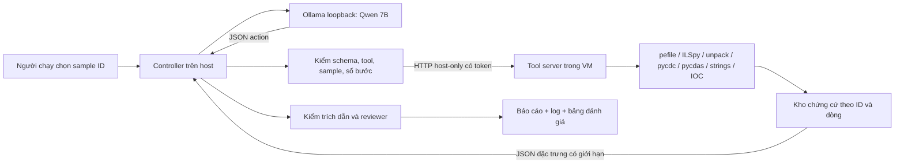

# Thuyết minh đề tài, thiết kế và luồng hoạt động

**Mục tiêu hiện tại: hoàn thành toàn bộ sản phẩm đồ án.** Buổi 4 là mốc tích hợp đã có bằng chứng, không phải đích nghiệm thu. Bản hiện tại chứng minh SLM cục bộ điều khiển công cụ thật trong VM trên mẫu public thật, có nhật ký; chất lượng phân tích vẫn cần hoàn thiện và đo. Tài liệu bàn giao theo yêu cầu người dùng là Markdown kỹ thuật, không cần thông tin sinh viên. Đọc cùng [STATUS](STATUS.md), [công việc còn lại](CONG_VIEC_CON_LAI.md), [hồ sơ huấn luyện](../training/README.md).

## 1. Dự án giải quyết bài toán gì?

Tên đề tài giữ theo file gốc: **Xây dựng AI Agent phân tích mã độc đánh cắp thông tin (Stealer) .NET/Python theo mô hình ReAct sử dụng SLM cục bộ**, hướng số 6.

Đầu vào là một file đã đăng ký trong thư mục mẫu của VM. Người phân tích cần biết định dạng, nội dung dịch ngược/bytecode, hành vi thu thập dữ liệu, kênh gửi, IOC như URL/webhook/token, kỹ thuật MITRE ATT&CK và luật YARA. Agent giúp chọn công cụ và tổng hợp chứng cứ; kết luận phải được kiểm và có thể trả “chưa đủ bằng chứng”.

Đồ án không tạo stealer và không cần cho stealer chạy để hoàn thành phạm vi tĩnh đã đề xuất. Những thao tác “đọc Login Data”, “gửi webhook” là đối tượng phân tích trong mã/chứng cứ, không là hành động mà agent được phép thực hiện.

Sản phẩm cuối là **hệ thống phân tích có thể kiểm toán**: source chạy được, cấu hình/model rõ nguồn, bộ mẫu có hash, nhật ký thực, báo cáo có trích dẫn, luật có kiểm chứng, bảng điểm đúng/sai/bịa/bỏ sót và thực nghiệm so sánh.

## 2. Thông số giảng viên và file đề xuất gốc

Các ảnh và tệp Markdown gốc được giữ nguyên tên/nội dung trong [reference](reference/). [Bảng nguồn yêu cầu](YEU_CAU_GIANG_VIEN.md) liên kết từng ảnh và file gốc.

| Nội dung | Thông số trên slide |
|---|---|
| Hướng | 6 – Agent stealer .NET / Python; độ khó Vừa |
| Mẫu I | .exe .NET, **5.632 byte** |
| Mẫu J | .exe PyInstaller, **khoảng 8 MB**; slide không cho số byte chính xác |
| Công cụ hướng 6 | ILSpy / dnSpyEx; pyinstxtractor + pycdc |
| Đầu ra riêng của hướng | Kênh gửi dữ liệu, token / webhook (IOC) |
| Model tối thiểu | SLM **7B** |
| Nhóm | Tối đa 4 sinh viên |
| Buổi 4 | Agent gọi được **ít nhất 2 công cụ** |
| Buổi 6 | Chạy trên **ít nhất 3 mẫu**, có nhật ký |
| Buổi 8 | Hoàn chỉnh và có bảng đánh giá |
| Bảo vệ | Demo trực tiếp + vấn đáp |

Người dùng xác nhận giảng viên không cấp mẫu. Vì vậy I/J trong slide là **mẫu tham chiếu về loại và phạm vi**, không có SHA256 để tìm đúng file. Nhóm dùng bộ public thay thế có định danh riêng; không đổi tên hoặc sửa kích thước để giả làm I/J.

File đề xuất gốc là kế hoạch, không phải biên bản kết quả. Ví dụ JSON có verdict malicious, TPR=1.0, FPR=0.0 trong file gốc chỉ minh họa schema. Không lấy các con số minh họa đó làm số đo của dự án.

## 3. Xây dựng từ repo tham khảo như thế nào?

Repo tham khảo Gera-YCYC/PhanTichMaDoc-Stealer được audit tại commit 9362d1c0c8455bb15ff089c4b7c0bbc5b0f356f4. [Báo cáo audit](../audit/AUDIT_REPORT.md) và [quyết định tái sử dụng](REUSE_DECISIONS.md) ghi phát hiện cụ thể.

Giữ ý tưởng tách module, ReAct, các nhánh .NET/Python, trích IOC và xuất JSON/Markdown. Phần điều phối được xây lại để lỗi công cụ không bị biến thành kết luận lành; công cụ thiếu không được giả làm công cụ thật; nhận định cần dòng chứng cứ; mẫu/tool ở VM thay vì chạy parser trực tiếp trên host.

Quy trình xây:

1. Chuyển yêu cầu slide thành điều kiện nghiệm thu trong PROJECT_GOAL.md.
2. Dựng VM, snapshot, mạng host-only và giao thức tool có xác thực.
3. Kiểm từng backend trước, rồi nối vòng agent dùng SLM thật.
4. Thêm schema action/report, giới hạn input/output, thời gian và bộ nhớ; ghi lỗi nguyên trạng.
5. Tạo nhật ký có hash chain, lưu version code/model và nguồn mẫu.
6. Chạy mẫu public, phân biệt chứng cứ tích hợp với chất lượng kết luận.
7. Dựng lại VM từ bộ cài nhóm, phục hồi model từ archive, nhập mẫu mã hóa và chạy lại.
8. Tách các phần chưa đạt thành backlog có người phụ trách và bằng chứng đóng việc.

## 4. Kiến trúc và trách nhiệm của từng phần



| Thành phần | File/module | Vai trò |
|---|---|---|
| Điểm chạy | agent_react.py, stealer_agent/cli.py | Chọn config/sample; cờ demo public bắt buộc hash đúng/model >=7B |
| ReAct | engine.py, prompts.py | SLM chọn action; controller giữ trạng thái, công cụ còn hợp lệ và giới hạn vòng |
| Hợp đồng | contracts.py | Schema action/report, danh sách tool và mã ATT&CK được phép |
| Giao tiếp | transport.py | Chỉ IP loopback cho model, IP riêng cho VM; không API LLM cloud |
| Tool VM | vm_tools/server.py, service.py, runner.py | Xác thực, kiểm cô lập, chạy parser/backend trong VM |
| Chứng cứ | vm_tools/evidence.py | ID chứng cứ, số dòng, đọc/tìm trang có giới hạn |
| Bảo vệ | security.py, vm_tools/isolation.py | Tên mẫu hợp lệ, giới hạn đường dẫn, lọc câu chèn, kiểm VM/gateway |
| Kiểm báo cáo | grounding.py, reviewer.py | Kiểm quote/line/source; reviewer SLM chỉ là heuristic |
| Nhật ký | journal.py, reporting.py, telemetry.py | JSONL, hash chain, báo cáo, token/time/RAM/VRAM |
| Đánh giá | eval/score.py, stability.py, injection.py | Chấm theo đáp án độc lập, stability và thử injection |
| YARA | yara_agent.py, vm_tools/yara_tools.py | SLM sinh đặc tả, YARA biên dịch và chạy thật. Trên bộ development, phát hiện 5/5 mẫu và 0/39 file sạch báo nhầm |

Host không mở binary mẫu để đưa cho SLM. VM chỉ trả đặc trưng/excerpt JSON; nội dung từ mẫu vẫn là dữ liệu không tin cậy. Model không có tool shell, không được chọn đường dẫn tùy ý hay tự đổi mẫu.

## 5. Vì sao chọn VM Ubuntu thay Windows + FLARE-VM?

Đề xuất gốc chọn Windows + FLARE-VM 4–6 GB RAM. Máy thực tế có khoảng 12 GB RAM và GPU 6 GB, cần chia tài nguyên cho host/SLM. Ubuntu 24.04 dùng 2 GB RAM/2 vCPU đã chạy ILSpy CLI và các công cụ Python tĩnh. Đây là thay đổi môi trường thực thi tool, không đổi đối tượng là file .NET/PyInstaller Windows.

VM dùng 192.168.56.101; host 192.168.56.1; API tool cổng 8765. Không default gateway, không NAT/bridged, shared folders/clipboard/drag-and-drop tắt. Tool server chạy user analyst, có token riêng. Kiểm hardware VM và route tự động hỗ trợ kiểm cấu hình hypervisor; chúng không chứng minh mọi thiết lập hypervisor tuyệt đối.

Linux VM chưa bao phủ phân tích động Windows. Phân tích động vốn nằm ngoài phạm vi đề xuất gốc. Không tính việc đổi VM là đã có FLARE-VM.

## 6. Chọn model dựa trên gì?

Giao diện điều tra dùng **Qwen3 8B**. Model đáp ứng mức 7B của hướng 6 và đã chạy được trên chính máy lab qua Ollama. Việc cố định tag, digest, cấu hình và ba hồ sơ cho phép đo tác động của bước duyệt đường truyền. Qwen2.5 Coder 7B vẫn là cấu hình dòng lệnh mặc định. [Phép đo bằng Qwen3 8B](DOI_CHIEU_DUONG_TRUYEN.md)

| Lựa chọn | Nhận xét và quyết định |
|---|---|
| Qwen2.5 1.5B có sẵn ở D | Dùng được cho smoke/phát triển, nhưng dưới mốc 7B của hướng 6; không chọn làm model chính |
| Qwen2.5 Coder 7B Instruct Q4_K_M | Chọn baseline vì thuộc dòng code, đáp ứng 7B và đã chạy được trên phần cứng thực tế |
| Model 7B tổng quát khác | Là đối chứng dự kiến; chưa có benchmark cùng bộ mẫu để tuyên bố Coder tốt hơn |
| Model lớn hơn hoặc API cloud | Không chọn cho bản này do tài nguyên và yêu cầu local |

Thông số đã quan sát: 7.615.616.512 tham số; tag qwen2.5-coder:7b; model khoảng 4,68 GB; Ollama runtime quan sát 0.40.17; VRAM sau một số run khoảng 4,20 GB theo API Ollama, không phải peak. Kho mới ở C/private/ollama-models. Kho 1.5B ở D được giữ nguyên.

Chọn Q4_K_M để giảm bộ nhớ suy luận là lựa chọn triển khai. **Tải model, lượng tử hóa Q4, viết prompt và đặt temperature không phải huấn luyện của nhóm.** Nguồn và giấy phép model được ghi tại [model card](../training/MODEL_CARD.md). Upstream mô tả Qwen2.5 Coder là dòng model phục vụ code: [model card chính thức](https://huggingface.co/Qwen/Qwen2.5-Coder-7B-Instruct). Việc nó phù hợp hơn model khác cho bài toán này còn cần thực nghiệm của nhóm.

## 7. Vì sao chọn các mẫu public hiện tại?

| Mẫu | Vai trò | Lý do chọn và giới hạn |
|---|---|---|
| Gomorrah, 85.041 B | Đại diện .NET thay vai trò I trong demo | Có nguồn nghiên cứu công khai, ILSpy đọc được mã quản lý. Bảng chấm phát triển khóa 40 mục và phân biệt chuỗi đứng riêng với đối số thật sự đi vào lời gọi. |
| PythonStealer 2024, 22.183.360 B | Đại diện PyInstaller thay vai trò J trong demo | Nhận diện được gói PyInstaller/Python 3.11. Khi pycdc gặp lỗi, agent chuyển sang bytecode và trích đoạn giải mã tĩnh. Bảng chấm phát triển khóa 36 mục. |
| AgentTesla, 608.768 B | .NET bổ sung cho >=3 mẫu | Có nguồn nghiên cứu SMTP; cần đối chiếu hành vi và IOC độc lập |
| LunaGrabber, 23.250.383 B | Ca khó Python/obfuscation | Giữ để đánh giá hạn chế, không chọn chỉ vì tên họ |
| Mercurial, 43.008 B | Ứng viên định dạng MSIL | Không dùng thay J vì nguồn MSIL không chứng minh Python |

Hash đầy đủ/nguồn ở [DATASET](DATASET.md) và [manifest](../config/public-samples.json). Kích thước lớn hơn slide là hệ quả chọn mẫu thay thế public, không phải lỗi đọc file. PythonStealer 2024 đã có chứng cứ tĩnh về kênh SMTP và tệp đính kèm. Trên Mercurial, kiểm nguồn ghi nhận một webhook có thành phần giống khóa ở dòng 37. Agent coverage bỏ sót chỉ dấu này. Xem [bằng chứng theo mẫu](DEMO_COVERAGE.md).

Tiêu chí chốt mẫu cuối: nguồn hợp lệ và hash ổn định; đúng nền tảng; phân tích được đủ luồng lấy dữ liệu → xử lý → gửi; có đáp án độc lập; thêm tập sạch/cases mới để kiểm báo nhầm và tổng quát hóa. Năm file hiện tại không tạo thành một benchmark thống kê đủ lớn.

## 8. Một lượt ReAct hoạt động ra sao?

Ví dụ chạy public_gomorrah.bin:

1. CLI kiểm tên trong manifest; đặt SHA256 mong đợi và yêu cầu 7B.
2. Preflight đọc metadata model và health VM. Thiếu tool, sai hash, sai mạng hoặc model không đủ thì dừng có lỗi.
3. Controller gửi prompt + schema + sample ID cho Ollama. SLM trả action JSON kèm lý do hành động ngắn.
4. Controller kiểm action, mẫu, tham số và tool còn hợp lệ. Action hợp lệ được gửi sang VM.
5. pefile xác định PE .NET. Kết quả thành observation có backend, hash, ID và dòng chứng cứ.
6. SLM nhận quan sát và chọn ILSpy, strings, IOC hoặc đọc thêm chứng cứ. Controller yêu cầu nhánh chuyên môn trước khi cho kết thúc.
7. Với Python: identify → unpack → pycdc; pycdc lỗi thì lỗi được giữ và nhánh pycdas được mở. Không coi bytecode là source C#/.py đã phục hồi.
8. Khi có báo cáo: controller kiểm quote thực sự tồn tại tại ID/dòng; reviewer xem hỗ trợ ngữ nghĩa. Claim bị loại vẫn lưu để chấm.
9. Xuất report và metrics. Inconclusive là kết quả hợp lệ khi thiếu bằng chứng; không tự đổi thành benign.

ReAct là cách tổ chức tương tác suy luận/hành động/quan sát, không tự yêu cầu cập nhật trọng số: [bài báo ReAct](https://arxiv.org/abs/2210.03629). Nhật ký dự án lưu lý do hành động ngắn, không cố thu chuỗi suy luận nội bộ.

## 9. Cấu hình hiện tại khác đề xuất gốc ở đâu?

| Hạng mục | File đề xuất | Đã triển khai |
|---|---|---|
| VM | Windows FLARE-VM, RAM 4–6 GB | Ubuntu 24.04, RAM 2 GB; phạm vi tĩnh |
| Nhận dạng | DIE | pefile/header và DIE 4.0.0 thật trong VM |
| Chuỗi | FLOSS, cả chuỗi giải mã | FLOSS 3.2.0; .NET static-only, native có emulation; strings riêng hỗ trợ UTF-8 |
| Python fallback | dis dự kiến | pycdas thật khi pycdc lỗi |
| Ngân sách | 15 bước, context 8192 | max_steps 16, num_ctx 8192, num_predict 2200; context code/tìm kiếm có giới hạn |
| Timeout | 120s/tool dự kiến | VM tool 90 s; HTTP/model 180 s theo config |
| Model | qwen2.5 hoặc coder7b | Coder 7B là baseline. Qwen3 8B chạy được hai nhánh và là cấu hình của đợt đo buổi 6 |
| Nhật ký | logs/ dạng ví dụ | runs/<run-id>/events.jsonl + reports và version hash |
| Mẫu/YARA | I/J; biến thể, 30–50 file sạch dự kiến | Public replacements; bộ đánh giá độc lập chưa hoàn thiện |

Không giữ giới hạn YARA filesize<10MB trong đề xuất một cách máy móc: mẫu Python hiện tại khoảng 22–23 MB, giới hạn đó sẽ bỏ sót ngay từ điều kiện kích thước.

Bảng ATT&CK của đề xuất cũng cần rà soát: T1555.004 là Windows Credential Manager, không phải mã chung cho mọi lời gọi DPAPI. Dùng mã theo hành vi được chứng minh: [MITRE T1555.004](https://attack.mitre.org/techniques/T1555/004/). File gốc được giữ nguyên; phần hiệu chỉnh nằm ở tài liệu/code hiện tại.

## 10. Cách chạy và cách đọc bằng chứng

Để demo bằng trình duyệt trên máy đã dựng, mở PowerShell ở thư mục gốc, chạy `.\scripts\Start-Web.ps1` và vào `http://127.0.0.1:4180`. Bản đồ cho mở từng đường nối, nhật ký tìm thêm và nhận định có trích dẫn cùng nguồn. [Các bước trình diễn](DOI_CHIEU_DUONG_TRUYEN.md)

Cài mới theo [TEAM_SETUP](TEAM_SETUP.md). Trên máy đã dựng:

```powershell
.\scripts\Start-Lab.ps1
.\.venv\Scripts\python.exe scripts/verify_lab.py
.\scripts\Run-Demo.ps1 -Sample public_gomorrah.bin
.\scripts\Run-Demo.ps1 -Sample public_python2024.bin
.\scripts\Stop-Lab.ps1
```

Start-Lab kiểm đúng tiến trình/model store, chờ READY. Run-Demo chỉ nhận mẫu public và kiểm hash. Mỗi run mới có thư mục riêng; không sync/restart service giữa lượt vì evidence ID theo session.

events.jsonl ghi response/action/observation, backend thật, lỗi và hash chain. report.model-raw.json giữ nhận định ban đầu; report.private.json giữ kết quả kiểm; report.md là bản đọc. Một chuỗi hash hợp lệ chứng minh tính nhất quán của file đã lưu, không chứng minh tác giả log hay nhận định đúng.

Hai lượt tổng duyệt lab gốc: .NET 4 tool/100,4s; Python 5 tool/90,9s. VM mới dựng lại: .NET 4 tool/92,6s; Python 5 tool/90,2s. Hai nhánh đều inconclusive, không có claim hành vi được xác nhận trong các lượt này. [Receipt chính](../deliverables/real-demo-evidence/receipt.json), [receipt VM mới](../deliverables/real-demo-evidence/clean-vm-rehearsal.json).

Server Ollama và VM được bật theo từng đợt kiểm chứng rồi dừng để trả RAM/VRAM. Người dùng đã cho phép chạy lại khi cần. Weight và disk VM vẫn ở ổ C; không tự xóa model/VM. Receipt tắt ở lần trước chỉ là lịch sử, không chứng minh runtime hiện tại đang tắt.

## 11. Train và việc còn lại

Đã train mô hình logistic regression phụ trợ xếp hạng điểm chứng cứ: 117 anchor từ output công cụ thật, 70 train/42 validation/5 test; có 300 bước optimizer, loss và checkpoint JSON. [Thực nghiệm và giới hạn](../training/RANKER_EXPERIMENT.md). Đây không phải fine-tune SLM: chưa có adapter/gradient update/loss Qwen của nhóm. Loại train GV yêu cầu vẫn chưa rõ; không đổi tên inference log thành training log hoặc tự gán xác nhận của GV.

Hồ sơ chuẩn bị nằm trong training/: nguồn model, trạng thái thực nghiệm, định dạng dữ liệu, cấu hình QLoRA dự kiến, validator và script ứng viên chưa chạy GPU. [Backlog](CONG_VIEC_CON_LAI.md) chỉ rõ module, điều kiện đóng việc và tiêu chí cuối môn. Tài liệu sản phẩm là Markdown kỹ thuật; không chờ tên/MSSV. Chỉ đánh dấu hoàn thành toàn đồ án sau khi có bằng chứng tương ứng.
